<p align="center"></p>

<p align="center">
  <picture>
    <source media="(prefers-color-scheme: dark)" srcset="https://readme-typing-svg.demolab.com?font=JetBrains+Mono&weight=600&size=22&duration=2800&pause=900&color=7DD3FC&center=true&vCenter=true&width=520&height=48&lines=Hola%2C%20soy%20Alejo.%20Me%20dicen%20Lobo.;Armo%20agentes%20y%20apps%20con%20LLMs;Claude%20Code%20es%20mi%20banda%20de%20sesi%C3%B3n;Firebase%2C%20Supabase%20y%20deploy;Desde%20Bah%C3%ADa%20Blanca%2C%20con%20distorsi%C3%B3n">
    <source media="(prefers-color-scheme: light)" srcset="https://readme-typing-svg.demolab.com?font=JetBrains+Mono&weight=600&size=22&duration=2800&pause=900&color=0284C7&center=true&vCenter=true&width=520&height=48&lines=Hola%2C%20soy%20Alejo.%20Me%20dicen%20Lobo.;Armo%20agentes%20y%20apps%20con%20LLMs;Claude%20Code%20es%20mi%20banda%20de%20sesi%C3%B3n;Firebase%2C%20Supabase%20y%20deploy;Desde%20Bah%C3%ADa%20Blanca%2C%20con%20distorsi%C3%B3n">
    
  </picture>
</p>

<p align="center"><sub><b>LOBO SUELTO RECORDS</b> · LSR-956 · una división de Cordero Atado S.R.L.</sub></p>

<p align="center"></p>

## 🐺 Lobo suelto

```text
                           lobo@bahia-blanca
                           -----------------
                           OS:       Bahía Blanca, Buenos Aires, AR
████████████████████████   Host:     Alejo Lobos · "Lobo"
███                  ███   Kernel:   Lic. en Cs. de la Computación · UNS
███   lobo  suelto   ███   Boot:     Técnico en Informática · La Piedad
███                  ███   Laburo:   Sistemas · Región Sanitaria I
████████████████████████               (salud pública de la Provincia, BB)
                                     Sistemas · Secretaría de Políticas
  ██████╗    ██████╗                   Sociales (Municipio de Bahía Blanca)
  ██╔══██╗   ██╔══██╗                Dev · SVN Designs
  ██████╔╝   ██████╔╝                  (cartelería y señalética, Miami)
  ██╔═══╝    ██╔══██╗      Clientes: Nova Padel Center (club de pádel)
  ██║        ██║  ██║      Cultura:  Activá Juventudes · referente
  ╚═╝        ╚═╝  ╚═╝      Shell:    Claude Code + PowerShell
  y sus redonditos de      Stack:    TS · React · Next · Firebase · Supabase
  código                   Idiomas:  Español · English (FCE, B2)
                           Banda:    guitarra en Roma En Clovery
                           Pedales:  DS-1 > OS-2 > CH-1 > MDT
                           Sonando:  Oasis · Los Redondos · el Indio
```

## 💿 Definitely Deploy

<p align="center"></p>

```text
╔════════════════════════════════════════╗
║  LOBO SUELTO RECORDS   LSR-956 · 2026  ║
║  D E F I N I T E L Y   D E P L O Y     ║
║  doce temas en producción      33 RPM  ║
╚════════════════════════════════════════╝

 LADO A
 ─────────────────────────────────────────
  A1  * Nova Padel .................. 7:30
        feat. JavaScript, Firebase & FCM
  A2  * Mi Mundial  (single) ........ 8:32
        feat. Next.js, Supabase & PL/pgSQL
  A3  * Casos SPS ................... 5:03
        feat. JavaScript, Firestore & PWA
  A4  * CFO Agéntico ................ 5:16
        feat. Firebase, QR de AFIP & OCR
  A5  * Percha ...................... 5:26
        feat. Claude (catálogo) & clima
  A6  * Stock Depósito .............. 5:29
        feat. Next.js, Firestore & QR
  A7  * Flight 956 .................. 6:00
        feat. React, TypeScript & Leaflet
  A8  * Mockups (en equipo) ......... 3:33
        feat. Node, OpenAI & SVN Designs
  A9  * Gestión Colectivos .......... 4:22
        feat. React, Firestore & push
  A10   Activá Juventudes ........... 5:03
        feat. HTML, CSS & 38 PRs
  A11 * Fixtura ..................... 5:04
        feat. JavaScript & Firebase
  A12   calendariojuli .............. 3:22
        feat. HTML & CSS
 ─── duración total 1:04:40 ──────────────

  * repo privado: se escucha en vivo,
    el master no se presta.
  duración = √(kB de código)/4 + 1:30
```

<p align="center"></p>

```text
╔════════════════════════════════════════╗
║  LOBO SUELTO RECORDS        LSR-956-B  ║
║  T H E   M A S T E R P L A N           ║
║  (o el Momo Sampler)  demos y rarezas  ║
╚════════════════════════════════════════╝

 LADO B
 ─────────────────────────────────────────
  B1    Tocadiscos (demo) ........... 3:15
        feat. Electron & Spotify
  B2    De regreso al Indio ......... 4:01
        feat. drag & drop & planilla
  B3    MapeoRS (ensayo) ............ 4:22
        feat. un solo HTML
  B4  * Seguimiento PEC ............. 4:21
        feat. React, Vite & Firestore
  B5  * Flyers SPS .................. 3:34
        feat. HTML & Firebase
  B6    Decime la Verdad (maqueta) .. 4:31
        feat. HTML, CSS & JS
  B7  * Picadito (sin letra) ........ 1:30
        feat. solo la partitura
  B8    EDD tengo que aprobar ....... 6:05
        feat. Java, a dúo
  B9  * GestoTickets ................ 3:29
        feat. HTML & Firebase
  B10   Club del Espectador ......... 3:38
        feat. HTML & CSS
 ─── duración total 38:46 ────────────────
```

<p align="center"></p>

## 🎤 Setlist · gira 2026

<sub>Lo que se toca esta noche, en orden, con los datos de cada repo. 🔒 = repo privado: la app se escucha en vivo, el master no se presta.</sub>

**01 · Nova Padel** &nbsp;`JavaScript` `85 commits` `desde abr 2026` 🟢 en producción<br>
Sistema de **Nova Padel Center**, un club de pádel de Bahía Blanca: reservas que no se pisan, torneos con zonas y llave armadas por un motor propio, quincho con combos y un tablero para la tele del club. El primer torneo de verdad (30 parejas) se jugó con el sistema y el papel en paralelo, por las dudas.<br>
<sub>[novapadel.com.ar](https://novapadel.com.ar/) · 🔒 privado</sub>

**02 · Mi Mundial · single** &nbsp;`TypeScript` `57 commits` `desde jul 2026` 🟢 en producción<br>
Organizador de picaditos: quién juega, quién lleva invitados, quién debe plata y el sorteo de equipos. La pantalla principal es **el camino**: cada triunfo te sube una instancia hasta la copa, y la derrota te manda a cero. Nació de leer tres semanas de un grupo de WhatsApp de fútbol y anotar qué se repetía.<br>
<sub>[en vivo](https://mimundial-eight.vercel.app) · 🔒 privado</sub>

**03 · Casos SPS** &nbsp;`JavaScript` `202 kB de código` `desde sep 2026` 🟢 en producción<br>
Seguimiento de casos para la **Secretaría de Políticas Sociales** del Municipio de Bahía Blanca: una mesa de entrada que deriva a áreas y personas, un panel de situaciones sociales con acceso restringido, avisos y PWA. Reemplazó una planilla de Excel.<br>
<sub>🔒 privado · uso interno</sub>

**04 · CFO Agéntico** &nbsp;`JavaScript` `34 commits` `desde jun 2026` 🟢 en producción<br>
Gestión para emprendedores: ingresos y egresos, estado impositivo (Monotributo o Responsable Inscripto) y proyección de gastos fijos. Las facturas se cargan leyendo el QR de AFIP, con OCR si no hay QR. El admin configura todo sin ver los datos de nadie.<br>
<sub>[en vivo](https://cfo-agentico.web.app) · 🔒 privado</sub>

**05 · Percha** &nbsp;`JavaScript` `11 commits` `desde oct 2026` 🟢 en uso<br>
Le sacás fotos a la ropa, Claude cataloga cada prenda (tipo, capa, color, abrigo, formalidad) y un motor de reglas propio lo cruza con el pronóstico por hora y la ocasión para proponer tres outfits, cada uno explicado.<br>
<sub>[en vivo](https://percha-seven.vercel.app) · 🔒 privado</sub>

**06 · Stock Depósito** &nbsp;`TypeScript` `49 commits` `desde jul 2026` 🟢 en producción<br>
Stock y entregas de un depósito de alimentos. Las entregas se registran escaneando un QR y descuentan stock en una transacción, así dos operadores a la vez no lo dejan en negativo. Los beneficiarios son merenderos y comedores.<br>
<sub>🔒 privado · uso interno</sub>

**07 · Flight 956** &nbsp;`TypeScript` `23 commits` `desde sep 2026` 🟡 publicada<br>
Para organizar un viaje entre amigos: gastos y quién le debe a quién, fondo común, valija con chequeo de ida y de vuelta, lugares en el mapa (Leaflet + OpenStreetMap, sin API keys) y qué se come cada día.<br>
<sub>[en vivo](https://flight956.web.app) · 🔒 privado</sub>

**08 · Mockups · grabado en equipo** &nbsp;`JavaScript` `223 commits, 15 míos` `desde jul 2026` 🟢 en producción<br>
**SVN Designs** es una empresa de cartelería y señalética de Miami. El generador convierte un doc de 2.545 líneas de prompts en un comando, en dos etapas: la ficha del producto y el letrero ya puesto en el local. Mi parte: la generación con gpt-image, formas y medidas que respetan lo que pidió el cliente, y cada corrida sellada con su versión. También toqué la intranet (compras, reuniones, una herramienta de nesting para aprovechar material) y **Icon**, el copiloto en Chrome: avisos, recordatorios y que sus escrituras se confirmen con un botón y no por chat.<br>
<sub>🔒 privado · repos de SVN Designs</sub>

**09 · Gestión Colectivos** &nbsp;`JavaScript` `23 commits` `desde jul 2026` 🟢 en producción<br>
Pedidos de colectivos y combis: los coordinadores cargan desde el celu y los administradores revisan y exportan desde un calendario. Push con FCM desde un endpoint en Vercel, sin Cloud Functions ni tarjeta.<br>
<sub>🔒 privado · uso interno</sub>

**10 · Activá Juventudes** &nbsp;`HTML` `135 commits · 38 PRs` `desde oct 2025` 🟢 en vivo<br>
La web de **Activá Juventudes**, espacio de juventudes de Bahía Blanca. 135 commits y 38 PRs: el único repo con flujo de PR de verdad.<br>
<sub>[sitio](https://activajuventudesymilitancia.com.ar/) · [repo](https://github.com/LoboSueltoPR/ActivaPaginaWeb)</sub>

**11 · Fixtura** &nbsp;`JavaScript` `203 kB de código` `desde ago 2026` 🟢 en producción<br>
Torneos de club: el organizador carga los nombres y el cuadro se arma solo. Los jugadores entran a un link, buscan su nombre y ven contra quién juegan, sin cuenta.<br>
<sub>[en vivo](https://fixtura-ar.web.app) · 🔒 privado</sub>

**12 · calendariojuli** &nbsp;`HTML` `48 commits` `desde dic 2024` 🟢 en vivo<br>
Calendario académico de la **UNISAL** (universidad, Bahía Blanca), embebido en su web. Chiquito, pero lo mira gente todos los días.<br>
<sub>[calendario](https://www.unisal.edu.ar/calendario-academico/) · [repo](https://github.com/LoboSueltoPR/calendariojuli)</sub>

### 🔁 Bis

**13 · Tocadiscos** &nbsp;`JavaScript` `Electron` `desde oct 2026` ⚪ demo<br>
Ventana flotante para Windows que muestra lo que suena en Spotify como un tocadiscos, con brazo y todo.<br>
<sub>[repo](https://github.com/LoboSueltoPR/tocadiscos)</sub>

**14 · De regreso al Indio** &nbsp;`HTML` `7 commits` `desde oct 2026` ⚪ se usó un domingo<br>
Plano interactivo del Parque Boronat para la jornada del 18/10: sectores que se arrastran, roles y tareas compartidas.<br>
<sub>[repo](https://github.com/LoboSueltoPR/plano-de-regreso-al-indio)</sub>

**15 · MapeoRS** &nbsp;`HTML` `17 commits` `desde may 2026` 🟢 en uso<br>
Mapa interactivo de la red de la Región Sanitaria I.<br>
<sub>[repo](https://github.com/LoboSueltoPR/MapeoRS)</sub>

**16 · Seguimiento PEC** &nbsp;`JavaScript` `8 commits` `desde oct 2026` 🟡 arrancando<br>
Lo que se acuerda con los territoriales de los Puntos de Encuentro Comunitario, acción por acción.<br>
<sub>🔒 privado</sub>

**17 · Flyers SPS** &nbsp;`HTML` `15 commits` `desde jun 2026` 🟢 en uso<br>
Pedido y administración de flyers para los PEC de la Secretaría.<br>
<sub>🔒 privado</sub>

**18 · Decime la Verdad** &nbsp;`HTML` `17 páginas` `desde jul 2026` ⚪ maqueta<br>
Maqueta navegable de 17 páginas para un canal de streaming.<br>
<sub>[maqueta](https://lobosueltopr.github.io/decimelaverdad-web/)</sub>

**19 · Picadito** &nbsp;`—` `solo docs` `desde jul 2026` ⚪ partitura<br>
Reservas de canchas multi-complejo, un subdominio por club. Por ahora es pura partitura: diseño y nada de código.<br>
<sub>🔒 privado</sub>

**20 · EDD tengo que aprobar** &nbsp;`Java` `38 commits, 17 míos` `desde may 2026` ⚪ facu<br>
Java para Estructuras de Datos (UNS), a dúo con un compañero.<br>
<sub>[repo](https://github.com/LoboSueltoPR/EDDtengoqueaprobar)</sub>

**21 · GestoTickets** &nbsp;`HTML` `7 commits` `desde jun 2026` 🟢 en uso<br>
Sistema de tickets de soporte, hermano del que uso en la Región Sanitaria.<br>
<sub>🔒 privado</sub>

**22 · Club del Espectador** &nbsp;`CSS` `8 commits` `desde abr 2025` ⚪ archivado<br>
Agenda semanal de teatro de los centros culturales de Bahía Blanca.<br>
<sub>[sitio](https://lobosueltopr.github.io/clubdelespectador/)</sub>

<p align="center"></p>

## 🎛️ Supersonic · cadena de señal

```text
GUITARRA · la madera, de la facu (UNS)
Java · C · Python · Prolog · estructuras
de datos · algoritmos
   │
┌──┴─────────────────────────────────────┐
│ BOSS DS-1 · Distortion          (o) ON │
│ DIST a las 3 · LEVEL a las 12          │
│                                        │
│ TypeScript · JavaScript · React 19     │
│ Next.js 16 · Vite · Tailwind v4        │
│ Electron · Leaflet · Canvas            │
│                                        │
│ > el que nunca apago                   │
└──┬─────────────────────────────────────┘
   │
┌──┴─────────────────────────────────────┐
│ BOSS OS-2 · Overdrive/Distortion(o) ON │
│ COLOR a las 12 · DRIVE a las 2         │
│                                        │
│ Firestore · Firebase Auth              │
│ Cloud Messaging · Supabase · Postgres  │
│ RLS · PL/pgSQL · migraciones           │
│                                        │
│ > mitad Firebase, mitad Supabase       │
└──┬─────────────────────────────────────┘
   │
┌──┴─────────────────────────────────────┐
│ BOSS CH-1 · Super Chorus        (o) ON │
│ DEPTH a las 4 · E.LEVEL al mango       │
│                                        │
│ Claude Code · Claude API · subagentes  │
│ MCP · skills · gpt-image               │
│ humano en el loop                      │
│                                        │
│ > uno solo suena como una banda        │
└──┬─────────────────────────────────────┘
   │
┌──┴─────────────────────────────────────┐
│ DEDALO MDT · Delay              (o) ON │
│ TIME a las 11 · FDBK a las 2           │
│                                        │
│ Vercel · Firebase Hosting              │
│ GitHub Pages · PWA · service workers   │
│ push · pwa-kit propio                  │
│                                        │
│ > cada repetición es un deploy         │
└──┬─────────────────────────────────────┘
   │
AMPLI · infra y redes (suena bajito)
pfSense · Squid/SquidGuard · LightSquid
servidor local · mapeo de red · soporte
```

## 🎚️ Standing on the Shoulder of Giants · personal técnico

```text
PRODUCCIÓN EJECUTIVA
  pipelines de IA generativa en producción
  en: generador de mockups · copiloto Icon

ARREGLOS DE IA
  orquestación: subagentes en paralelo
  en: Claude Code, todos los días

INGENIERÍA DE CONTEXTO
  CLAUDE.md, handoffs, memoria y skills
  en: Obsidian como segundo cerebro

CONEXIONES (MCP)
  Claude enchufado a datos reales
  en: Obsidian · Firebase · Google Drive

SEGURIDAD DE SALA
  guardrails y humano en el loop
  en: Icon escribe solo si tocás un botón

PARTITURAS
  spec-driven: spec → plan → slices
  en: Picadito (fase 0: todo spec)

SESIONISTA PRINCIPAL
  Claude Code a diario, de idea a deploy
  en: todo este disco

INGENIERÍA DE DATOS
  reglas como backend, transacciones, SQL
  en: Stock Depósito · Mi Mundial

MEZCLA Y MASTERING
  PWAs instalables, push, sin servidor
  en: pwa-kit en 7 apps · Vercel

PLOMO DE GIRA
  redes, proxy, servidor y soporte
  en: Región Sanitaria I
```

<sub>Grabado en Bahía Blanca entre mates y deploys. Mezclado con Claude Code. Masterizado en Vercel y Firebase.
Gracias a quienes usan estos temas de verdad: el club, la Secretaría, los merenderos y los del picadito.</sub>

## 🚌 Último bondi a Finisterre

[GitHub](https://github.com/LoboSueltoPR) · Bahía Blanca, Argentina

<sub>℗ 2026 Lobo Suelto Records. Fabricado en Argentina. Live forever.</sub>

<details>
<summary><sub>· · ·</sub></summary>
<br>

**Track 13 · bonus track oculto · Desconexión**<br>
Mi tema solista. Todavía no tiene deploy.

</details>
