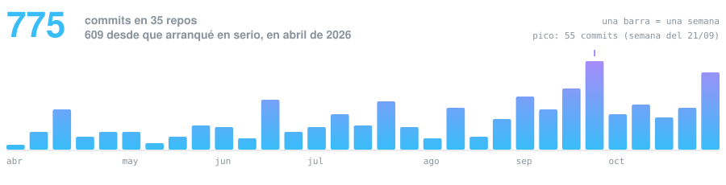

Commits en todos mis repos, públicos y privados, más los de SVN Designs.

## Proyectos

| Proyecto | Qué es | Stack | |
|---|---|---|---|
| **Nova Padel** | Reservas, torneos con zonas y llave, quincho y tablero para la tele de un club de pádel | JS · Firebase | [sitio](https://novapadel.com.ar/) 🔒 |
| **Mi Mundial** | Organizador de picaditos: quién juega, quién debe plata y sorteo de equipos | TS | [en vivo](https://mimundial-eight.vercel.app) 🔒 |
| **Casos SPS** | Mesa de entrada y seguimiento de casos de la Secretaría de Políticas Sociales (Municipio de Bahía Blanca) | JS | 🔒 uso interno |
| **CFO Agéntico** | Ingresos, egresos y estado impositivo para emprendedores; facturas por QR de AFIP u OCR | JS · Firebase | [en vivo](https://cfo-agentico.web.app) 🔒 |
| **Percha** | Claude cataloga tu ropa por foto y arma outfits según el pronóstico | JS · Claude API | [en vivo](https://percha-seven.vercel.app) 🔒 |
| **Stock Depósito** | Stock y entregas por QR de un depósito de alimentos para merenderos y comedores | TS | 🔒 uso interno |
| **Flight 956** | Viaje entre amigos: gastos, fondo común, valija y mapa | TS · Leaflet | [en vivo](https://flight956.web.app) 🔒 |
| **Gestión Colectivos** | Pedidos de colectivos y combis con calendario y push | JS · FCM · Vercel | 🔒 uso interno |
| **Fixtura** | Torneos de club: el cuadro se arma solo y los jugadores lo ven por link | JS | [en vivo](https://fixtura-ar.web.app) 🔒 |
| **Activá Juventudes** | Web del espacio de juventudes de Bahía Blanca | HTML | [sitio](https://activajuventudesymilitancia.com.ar/) · [repo](https://github.com/LoboSueltoPR/ActivaPaginaWeb) |
| **calendariojuli** | Calendario académico de la UNISAL, embebido en su web | HTML | [calendario](https://www.unisal.edu.ar/calendario-academico/) · [repo](https://github.com/LoboSueltoPR/calendariojuli) |
| **MapeoRS** | Mapa de la red de la Región Sanitaria I | HTML | [repo](https://github.com/LoboSueltoPR/MapeoRS) |
| **Flyers SPS** | Pedido y administración de flyers para los PEC de la Secretaría | HTML | 🔒 |
| **Seguimiento PEC** | Acuerdos con los territoriales de los Puntos de Encuentro Comunitario | JS | 🔒 |
| **GestoTickets** | Sistema de tickets de soporte | HTML | 🔒 |
| **Tocadiscos** | Lo que suena en Spotify, como un tocadiscos flotante en Windows | Electron | [repo](https://github.com/LoboSueltoPR/tocadiscos) |
| **De regreso al Indio** | Plano interactivo del Parque Boronat para la jornada del 18/10 | HTML | [repo](https://github.com/LoboSueltoPR/plano-de-regreso-al-indio) |
| **Club del Espectador** | Agenda semanal de teatro de Bahía Blanca | CSS | [sitio](https://lobosueltopr.github.io/clubdelespectador/) |

## En equipo

| Proyecto | Mi parte | Stack | |
|---|---|---|---|
| **Generador de mockups** · SVN Designs | Generación con gpt-image, formas y medidas fieles al pedido del cliente, corridas versionadas | JS · gpt-image | 🔒 |
| **Intranet** · SVN Designs | Compras, reuniones y herramienta de nesting para aprovechar material | JS | 🔒 |
| **Icon** · SVN Designs | Copiloto en Chrome: avisos, recordatorios y escrituras confirmadas con un botón | JS · Chrome | 🔒 |
| **EDD tengo que aprobar** · UNS | Estructuras de Datos, a dúo | Java | [repo](https://github.com/LoboSueltoPR/EDDtengoqueaprobar) |

🔒 = repo privado
